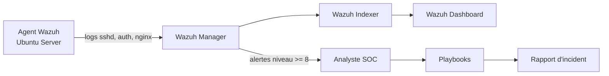

# 🛡️ DjibSOC-Lab — Mini-SOC avec Wazuh, règles de détection et playbooks

Laboratoire SOC reproductible : **détection → alerte → investigation → réponse → rapport**.
Projet inspiré de mon expérience en déploiement SIEM (Wazuh, Microsoft Sentinel), analyse de journaux,
réponse aux incidents et alignement sur **MITRE ATT&CK**, **ISO 27001** et **NIST CSF**.

> ⚠️ Projet à but éducatif. À utiliser uniquement dans un laboratoire que vous possédez.
> Les adresses IP utilisées sont des IP de documentation (RFC 5737 : `203.0.113.0/24`).

## 🎯 Objectifs

- Écrire des **règles de détection personnalisées** pour Wazuh, mappées à MITRE ATT&CK.
- Tester les règles avec des **journaux simulés** (aucune attaque réelle).
- Fournir des **playbooks de réponse aux incidents** en français.
- Fournir des **requêtes KQL** équivalentes pour Microsoft Sentinel.

## 🏗️ Architecture



## 📁 Structure

```
rules/              Règles Wazuh personnalisées (local_rules.xml)
scripts/            Générateur de journaux de test (inoffensif)
playbooks/          Procédures de réponse aux incidents (FR)
detections/sentinel Requêtes KQL pour Microsoft Sentinel
docs/               Mapping MITRE ATT&CK, ISO 27001, NIST CSF
templates/          Modèle de rapport d'incident
```

## 📊 Règles de détection

| ID règle | Détection | Niveau | MITRE ATT&CK |
|---|---|---|---|
| 100001 | Brute force SSH sur comptes inexistants (6 échecs / 60 s, même IP) | 10 | T1110 |
| 100002 | Création d'un compte utilisateur | 8 | T1136.001 |
| 100003 | Élévation de privilèges `sudo` vers root | 6 | T1548.003 |
| 100004 | Scan web (10 erreurs 400 en 30 s, même IP) | 9 | T1595 |
| 100005 | Connexion SSH réussie après un brute force (même IP, 5 min) | 14 | T1110, T1078 |

## 🚀 Installation

### Option A — Wazuh installé nativement (testé dans ce lab)

1. Installer Wazuh (manager, indexer, dashboard) en suivant la documentation officielle.
2. Sauvegarder le fichier existant, puis copier les règles :
   ```bash
   sudo cp /var/ossec/etc/rules/local_rules.xml ~/local_rules.xml.bak
   sudo cp rules/local_rules.xml /var/ossec/etc/rules/local_rules.xml
   sudo chown wazuh:wazuh /var/ossec/etc/rules/local_rules.xml
   sudo chmod 660 /var/ossec/etc/rules/local_rules.xml
   ```
3. Vérifier la syntaxe, puis redémarrer le manager (compter 30 à 60 secondes) :
   ```bash
   sudo /var/ossec/bin/wazuh-analysisd -t && sudo systemctl restart wazuh-manager
   ```

### Option B — Wazuh avec Docker (non testée dans ce lab)

Voir le dépôt officiel `wazuh/wazuh-docker` (déploiement single-node), puis copier
`rules/local_rules.xml` dans le conteneur manager (`/var/ossec/etc/rules/`) et redémarrer.

## 🧪 Tester les règles (sans attaque réelle)

```bash
python3 scripts/generate_test_logs.py --scenario new_user       | /var/ossec/bin/wazuh-logtest
python3 scripts/generate_test_logs.py --scenario sudo_root      | /var/ossec/bin/wazuh-logtest
python3 scripts/generate_test_logs.py --scenario web_scan       | /var/ossec/bin/wazuh-logtest
python3 scripts/generate_test_logs.py --scenario ssh_bruteforce | /var/ossec/bin/wazuh-logtest
```

### Test de la règle critique 100005 (brute force puis connexion réussie)

```bash
python3 scripts/generate_test_logs.py --scenario ssh_bruteforce > /tmp/chain.log
echo "$(LC_ALL=C date '+%b %e %H:%M:%S') srv-lab sshd[2100]: Accepted password for analyste from 203.0.113.50 port 5555 ssh2" >> /tmp/chain.log
(cat /tmp/chain.log; sleep 3) | /var/ossec/bin/wazuh-logtest
```

> 💡 Utilisez `LC_ALL=C` avec `date`. Sur un système en français, le mois s'écrit `oct.`
> et Wazuh ne décode pas la ligne de log.

## ✅ Résultats des tests

Environnement : **Wazuh 4.7.5**, installation native sous Ubuntu, validation avec `wazuh-logtest`.

| Scénario | Règle déclenchée | Niveau | MITRE |
|---|---|---|---|
| `new_user` | 100002 | 8 | T1136.001 |
| `sudo_root` | 100003 | 6 | T1548.003 |
| `web_scan` | 100004 | 9 | T1595 |
| `ssh_bruteforce` | 100001 | 10 | T1110 |
| brute force + connexion réussie | 100005 | 14 | T1110, T1078 |

### Leçons apprises

- Les règles de corrélation s'appuient sur des règles existantes de Wazuh : `5710` (utilisateur inexistant),
  `5715` (succès d'authentification), `5403` (premier `sudo`) et `31101` (erreur web 400).
- Ma première version de 100001 se basait sur la règle `5760` : elle ne se déclenchait pas, car les lignes
  `invalid user` sont classées en `5710`. Corrigé après test avec `wazuh-logtest`.
- La règle 100003 devait aussi couvrir `5403` (premier usage de `sudo` par un utilisateur).
- La règle 100005 nécessite un `timeframe` pour corréler le brute force et la connexion réussie.
- 100001 ne compte que les échecs sur des **comptes inexistants** (5710). Une règle séparée
  pourra couvrir les mots de passe faux sur un compte existant (5760).

## 📚 Playbooks

- [PB-01 — Brute force SSH](playbooks/PB-01-bruteforce-ssh.md)
- [PB-02 — Création de compte suspecte](playbooks/PB-02-compte-suspect.md)
- [PB-03 — Scan / reconnaissance web](playbooks/PB-03-scan-web.md)

## 🗺️ Feuille de route

- [ ] Règle pour les mots de passe faux sur compte existant (5760)
- [ ] Réponse active Wazuh (blocage IP via `firewall-drop`)
- [ ] Intégration Threat Intelligence (AbuseIPDB / MISP)
- [ ] Captures d'écran du dashboard
- [ ] Automatisation avec Shuffle (SOAR)

## 👤 Auteur

**Abdoulkader Abdila Mohamed** — Analyste SOC · Ingénieur Cybersécurité · Gouvernance & Conformité
📧 gilisabdoulkader@gmail.com · 🔗 github.com/mekladeveloppeur

## 📄 Licence

MIT
