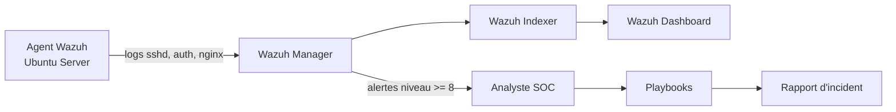

# 🛡️ DjibSOC-Lab — Mini-SOC avec Wazuh, règles de détection et playbooks

Laboratoire SOC reproductible : **détection → alerte → investigation → réponse → rapport**.
Projet inspiré de mon expérience en déploiement SIEM (Wazuh, Microsoft Sentinel), analyse de journaux,
réponse aux incidents et alignement sur **MITRE ATT&CK**, **ISO 27001** et **NIST CSF**.

> ⚠️ Projet à but éducatif. À utiliser uniquement dans un laboratoire que vous possédez.
> Les adresses IP utilisées sont des IP de documentation (RFC 5737 : `203.0.113.0/24`).

## 🎯 Objectifs

- Déployer un SIEM Wazuh (manager + indexer + dashboard) et un agent Linux.
- Écrire des **règles de détection personnalisées** mappées à MITRE ATT&CK.
- Tester les règles avec des **journaux simulés** (aucune attaque réelle).
- Fournir des **playbooks de réponse aux incidents** en français.
- Fournir des **requêtes KQL** équivalentes pour Microsoft Sentinel.

## 🏗️ Architecture



## 📁 Structure

```
rules/              Règles Wazuh personnalisées (local_rules.xml)
scripts/            Générateur de journaux de test (inoffensif)
playbooks/          Procédures de réponse aux incidents (FR)
detections/sentinel Requêtes KQL pour Microsoft Sentinel
docs/               Mapping MITRE ATT&CK, ISO 27001, NIST CSF
templates/          Modèle de rapport d'incident
```

## 🚀 Installation rapide

1. Déployer Wazuh en single-node avec Docker (procédure officielle) :
   ```bash
   git clone https://github.com/wazuh/wazuh-docker.git -b v4.9.0
   cd wazuh-docker/single-node
   docker compose -f generate-indexer-certs.yml run --rm generator
   docker compose up -d
   ```
   (Vérifiez la dernière version stable sur la documentation Wazuh.)
2. Installer un agent Wazuh sur une VM Ubuntu et l'enregistrer auprès du manager.
3. Copier les règles dans le manager :
   ```bash
   docker cp rules/local_rules.xml single-node-wazuh.manager-1:/var/ossec/etc/rules/local_rules.xml
   docker exec single-node-wazuh.manager-1 /var/ossec/bin/wazuh-control restart
   ```

## 🧪 Tester les règles (sans attaque réelle)

```bash
python3 scripts/generate_test_logs.py --scenario ssh_bruteforce > /tmp/test.log
docker exec -i single-node-wazuh.manager-1 /var/ossec/bin/wazuh-logtest < /tmp/test.log
```

Scénarios disponibles : `ssh_bruteforce`, `new_user`, `sudo_root`, `web_scan`.

## 📊 Règles de détection

| ID règle | Détection | Niveau | MITRE ATT&CK |
|---|---|---|---|
| 100001 | Brute force SSH (6 échecs/60 s, même IP) | 10 | T1110 |
| 100002 | Création d'un compte utilisateur | 8 | T1136.001 |
| 100003 | Élévation de privilèges `sudo` vers root | 6 | T1548.003 |
| 100004 | Scan web (10 erreurs 400 en 30 s, même IP) | 9 | T1595 |
| 100005 | Brute force SSH suivi d'une connexion réussie | 14 | T1110 / T1078 |

## 📚 Playbooks

- [PB-01 — Brute force SSH](playbooks/PB-01-bruteforce-ssh.md)
- [PB-02 — Création de compte suspecte](playbooks/PB-02-compte-suspect.md)
- [PB-03 — Scan / reconnaissance web](playbooks/PB-03-scan-web.md)

## 🗺️ Feuille de route

- [ ] Réponse active Wazuh (blocage IP via `firewall-drop`)
- [ ] Intégration Threat Intelligence (AbuseIPDB / MISP)
- [ ] Dashboard Grafana des alertes
- [ ] Automatisation avec Shuffle (SOAR)

## 👤 Auteur

**Abdoulkader Abdila Mohamed** — Analyste SOC · Ingénieur Cybersécurité · Gouvernance & Conformité
📧 gilisabdoulkader@gmail.com · 🔗 github.com/mekladeveloppeur

## 📄 Licence

MIT
